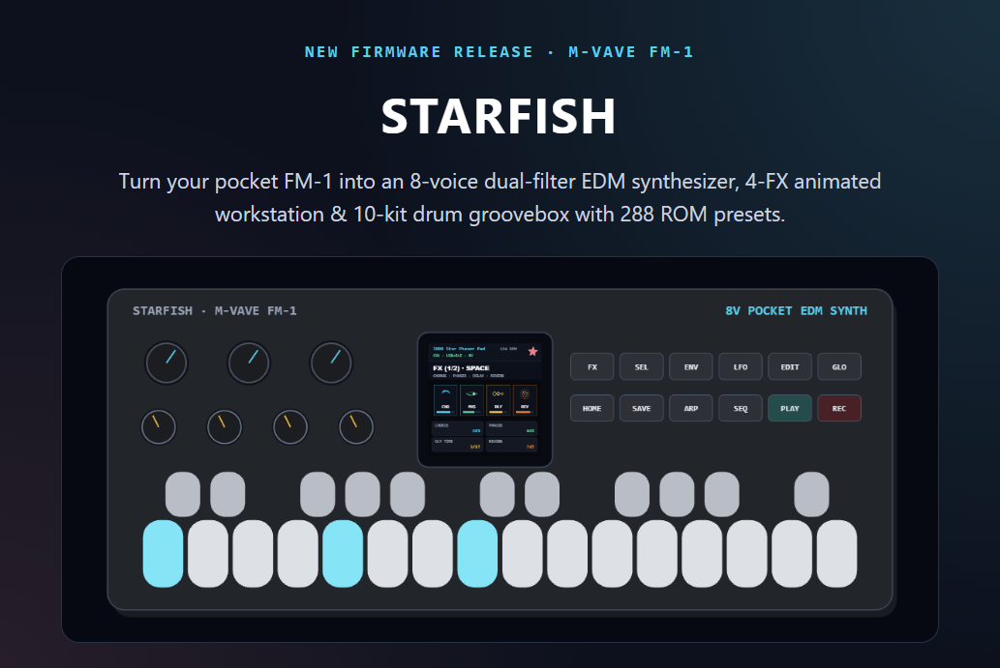

# STARFISH for M-VAVE FM-1
**An 8-Voice Virtual Analog & Hypersaw Synthesizer · Dual Multimode Filters · 4-Icon FX Rack · 10-Kit Drum Sequencer · 288 Curated Presets + 128 User Flash Slots**

STARFISH transforms the **M-VAVE FM-1** into a portable synthesizer and groovebox, featuring an expanded sound engine, expressive effects, extensive preset management and an integrated drum sequencer.

---

## 🚀 Explore STARFISH

**Everything is accessible directly through your browser.**

| Resource | Description |
|:---|:---|
| 🌐 **[Emulator](https://grandsummoner.github.io/starfish/emu/)** | Install STARFISH firmware over USB-MIDI, restore stock firmware and inspect device crash reports. |
| 🌐 **[Installer](https://grandsummoner.github.io/starfish/)** | Install STARFISH firmware over USB-MIDI, restore stock firmware and inspect device crash reports. |
| 📖 **[User Guide](https://grandsummoner.github.io/starfish/guide.html)** | Explore hardware controls, OLED simulations, the drum sequencer, all 288 presets and MIDI routing. |

All three applications share a common navigation bar for easy switching between the installer, guide and promotional showcase.

---

## 🎹 Synthesizer & Sound Engine

**Core implementation:** `app/dsp.c`, `app/presets.h`, `app/presets_rom.h`

- **8-Voice Dual Oscillator Engine (`EDIT 1/3–3/3`):** HYPERSAW, SAW, PULSE, TRIANGLE, HARD SYNC and WAVETABLE, with Sub-Oscillator (SQUARE / SINE / SAWTOOTH), Noise, Ring Modulation, FM cross-modulation and up to 5-voice Unison spread.
- **Dual Resonant Filters (`HOME 1/3` & `SEL 1/2–2/2`):** CUTOFF 1/2 and RESO 1/2 on `HOME 1/3`, LP/BP/HP/NOTCH modes with Serial, Parallel and Split routing + Filter Balance (`SEL 1/2`), and F-ENV, KEYFLW, F2 ENV (-100% to +100%) and VEL SENS (0–100%) on `SEL 2/2`, including real-time OLED frequency-response plotting.
- **Per-Patch Processing (`HOME 2/3`):** Auto-saved PATCH GAIN (-12 to +12 dB), TILT EQ (-7 to +7), M/S WIDTH (0–200%) and transient PUNCH (0–100%).
- **Scales, Themes, Voice Mode & Randomizer (`GLO 1/4–3/4`):** Root, 12 musical Scales, 5 Chord Memory modes and Master Tempo (40–240 BPM) on `GLO 1/4`; 8 unified OLED + Starfish colour themes (`MONOLITH` mono to `PRISM` rainbow and generative `RANDOM`), `VOICE MODE` (`POLY` / `MONO` / `LEGATO`), `POLY` (1V–8V) and `AT DEST` (`CUTOFF` / `VIBRATO` / `RESO` / `DRIVE` / `AMP` / `OFF`) on `GLO 2/4`; Styled Patch Randomizer (8 styles + CHAOS) with Bank X slot selection on `GLO 3/4`.
- **9-Mode Arpeggiator (`ARP 1/2–2/2`):** BPM-synchronised rates (1/4 to 1/32T) with UP, DOWN, UP/DN, RAND, RND WLK, ORDER and ROTATE (S/M/F), Latch, 1–3 Octaves, Density, Gate and Accent.

### 4-Icon Effects Rack

The FX interface features four animated OLED visualisation boxes, inspired by [Vinish's Free VFX sprite collection](https://vinish.dev/free-vfx).

Visual themes include water ripples, force-field arcs, comet echoes, magic aura embers, beam splitters, spiral portal vortexes, lightning crests and flame cores.

Available effects:

- BBD Chorus
- Phaser
- BPM-synchronised Stereo Delay
- Reverb
- Analog Saturation (SOFT / TUBE / HARD / OFF)

### Modulation

- **Dual ADSR Envelopes:** Dedicated Amp and Filter envelopes with live trigger tracing.
- **Dual Independent LFOs & Swarm Drift:** CUT1, CUT2, RESO, PITCH, PAN, SPREAD, AMP, CHORUS, PHASER, DELAY and REVERB destinations, plus Analog Swarm Drift.
- **Expressive Aftertouch (`GLO 2/4`):** Polyphonic keybed touch pressure and MIDI Poly/Channel Aftertouch routable to Filter 1 Cutoff, Vibrato, Resonance, Saturation Drive, Amplitude or Off.
- **Automatic Protection:** FX and amplifier headroom protection.

---

## 💾 Preset Management & Memory

### Factory ROM — 288 Curated Presets

Nine read-only banks organised by sound category:

| Bank | Sound Category |
|:---:|:---|
| A | Pads |
| B | Leads |
| C | Bass |
| D | Plucks |
| E | Keys / Organs |
| F | Arpeggios |
| G | Wobbles |
| H | FX / Drones |
| I | STARFISH Originals |

Factory ROM banks remain read-only. Saving edited sounds routes them into the user flash bank instead.

### User Flash Bank X

- 128 writable patch slots: `X000–X127`
- Stores custom patches and randomised patches.
- Supports drum and live synth loop sequence edits.
- Per-patch gain settings are automatically saved without overwriting factory synth parameters.

---

## 🥁 Drum Machine & Sequencer

### 10 Integrated Drum Kits

`TR-808` · `TR-909` · `FM ACOUSTIC` · `CRISP DIGI` · `GLITCH` · `INDUSTRIAL` · `ANALOG` · `ACOUSTIC` · `8-BIT` · `STARFISH`

### 27-Key Touch Sequencer

The touch interface provides dedicated controls for drum selection and step programming (`SEQ 1/3–3/3`).

- Upper 8 black keys: Select drum voices (BD–RS) and per-voice Tune, Decay, Tone and Level.
- Bottom 16 white keys: Toggle sequencer steps 1–16 across 1–4 bars or SYNC SEQ.
- Top-right key (`MUTE/CLR`): Tap to mute track, hold 0.6s to clear track.
- Sequencer engine (`SEQ 2/3–3/3`): Euclidean rhythm generator, Swing (50–75%), 12 built-in drum patterns (`TECHNO`–`GARAGE` + `CUSTOM`), and Quantized/Free live synth loop recording (`REC`).
- Synth mode: Recorded notes illuminate corresponding capsule keys during playback.

### Global Mixing (HOME 3/3)

- SYNTH LVL
- KICK DUCK sidechain
- DUCK SRC (BD / SD / CH / OH / CP / TM / RD / RS)
- DRM LVL

---

## 🔊 Audio, MIDI & Connectivity

### USB Audio

- Full 44.1 kHz USB Audio and USB-MIDI output.
- Independent hardware speaker/headphone `OUT LEVEL` control (`GLO 4/4`).
- Output levels: AUTO 0dB, LINE -6dB and BOOST +3dB.

### Bluetooth MIDI

- Hold `GLO + HOME` to open the BLE MIDI device scanner.
- Configure `BT MIDI` role (`PC + KYBD`, `KYBD HOST`, `PC DEVICE`, `OFF`), `SYNTH CH` (`OMNI` / `1–16`) and `DRUM CH` (`OFF` / `1–16`) on `GLO 4/4`.

---

## ✨ STARFISH Boot Experience & Easter Egg

The STARFISH boot sequence features an OLED banner across six boot scenes.

An additional hidden feature is accessible through the OCT- and OCT+ buttons:

- Press both buttons together.
- Plays a chorus-enhanced three-voice Hypersaw Cmaj9 shimmer.
- Opens the About App overview page.

Implementation: `sf_dsp_start_easter_egg`

---

## 📜 Credits & License

**License:** [Mozilla Public License 2.0 (MPL-2.0)](LICENSE)

STARFISH builds upon the following projects:

- [FM1 Base Firmware](https://github.com/charlesvestal/fm1-base)
- [Felucca Board Support Package](https://github.com/hugelton/felucca-bsp)
