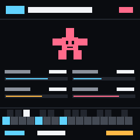

# STARFISH Manual

STARFISH turns the M-VAVE FM-1 into an 8-voice Starfish VA synth + 8-track drum sequencer with 1,056 built-in presets across Banks A-I and 32 flash user slots in Bank X.

## Navigation & Panel Map

- **SELECT**: Browse Banks `A` through `I` and `X` on Home; Drum Bus (`CLEAN / COMP / CRUSH`) in `SEQ`.
- **PRESET**: Scroll presets inside the current bank; Drum Kit (`TR-808` .. `STARFISH`) in `SEQ`.
- **ALGO**: Cycle Home Starfish mascot scene, ENV amp/filter subpage, Saturation mode, or LFO shape.
- **K1 - K4**: Direct tactile control of the 4 shown parameters on any page.
- **OCT- / OCT+**: Shift keyboard octave `-2 .. +2` (or Confirm/Discard when prompted for an `UNSAVED RANDOM` patch).
- **ARP**: Short press toggles Arpeggiator ON/OFF. Hold 0.5 s for Arp settings (`RATE`, `MODE`, `OCT`, `LATCH`). Hold `ARP + OCT+` to toggle Latch.
- **SEQ**: Opens the 8-voice Drum Sequencer. Top black keys `0-7` select drum voices (`BD..CY`); bottom 16 white keys toggle steps `1-16`; extreme top-right black key toggles Mute (hold 0.6 s to Clear).
- **GLO**: Cycles Scale/Root/Chord (Page 1), Randomizer Chaos & Style (Page 2), Theme & BLE (Page 3).
- **SAVE**: Press once to choose `SAVE TO BANK X`, `INIT PATCH`, or `RANDOMIZE`; press `SAVE` again to execute.
- **REC**: Short press scans Bluetooth MIDI devices; hold 1 s to toggle Bluetooth radio power.
